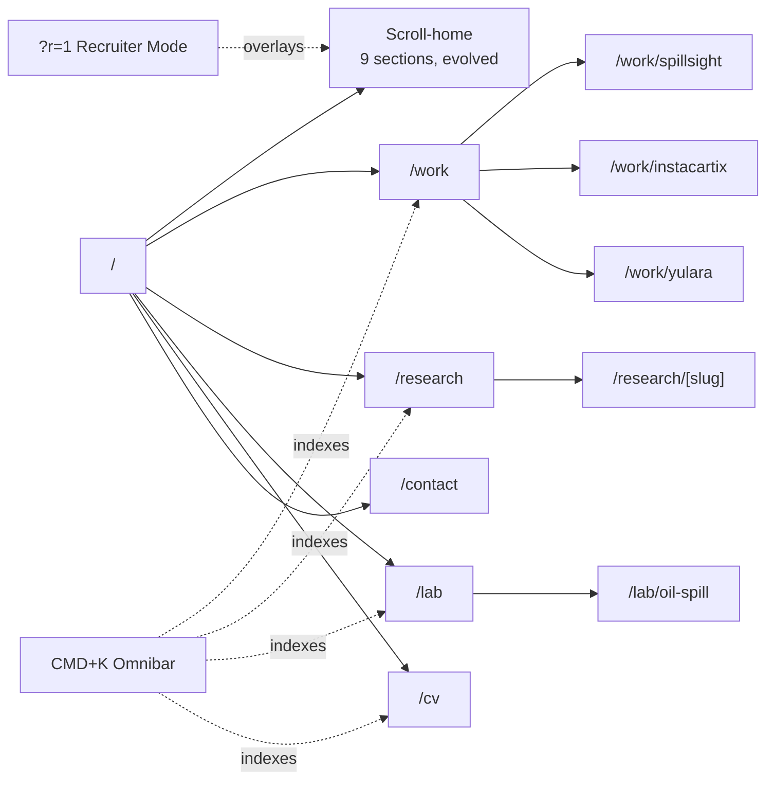
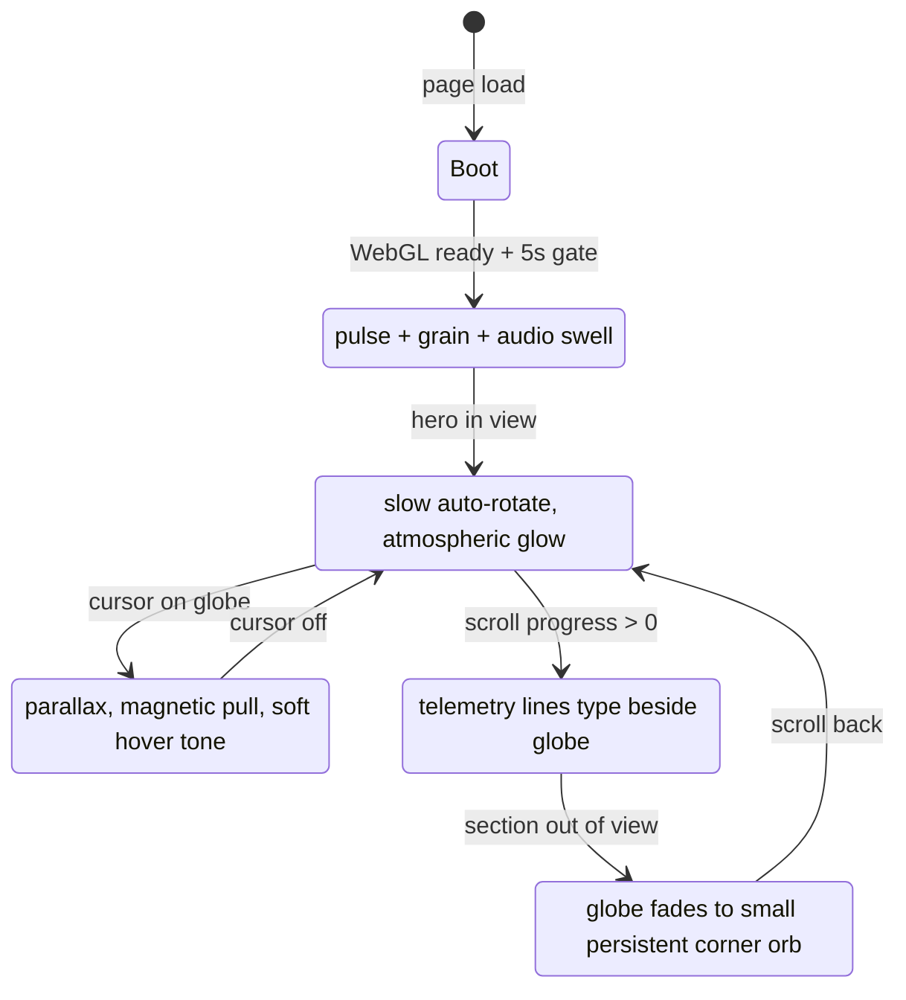
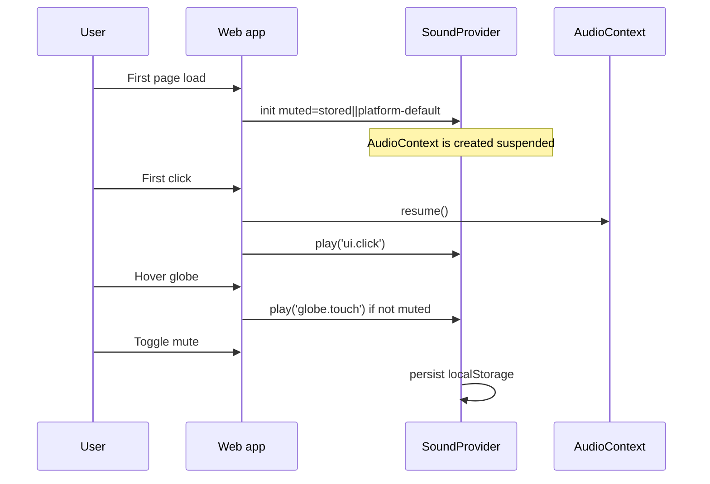
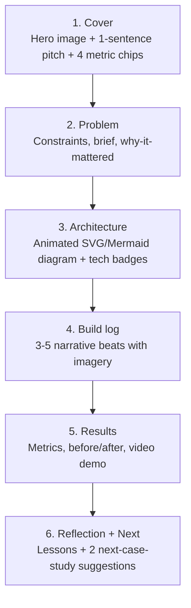
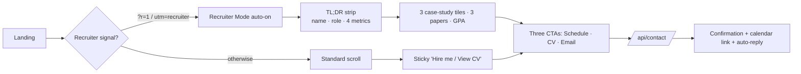
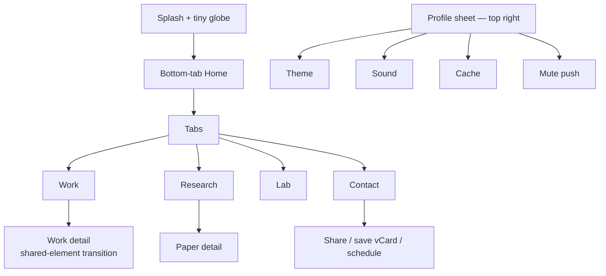
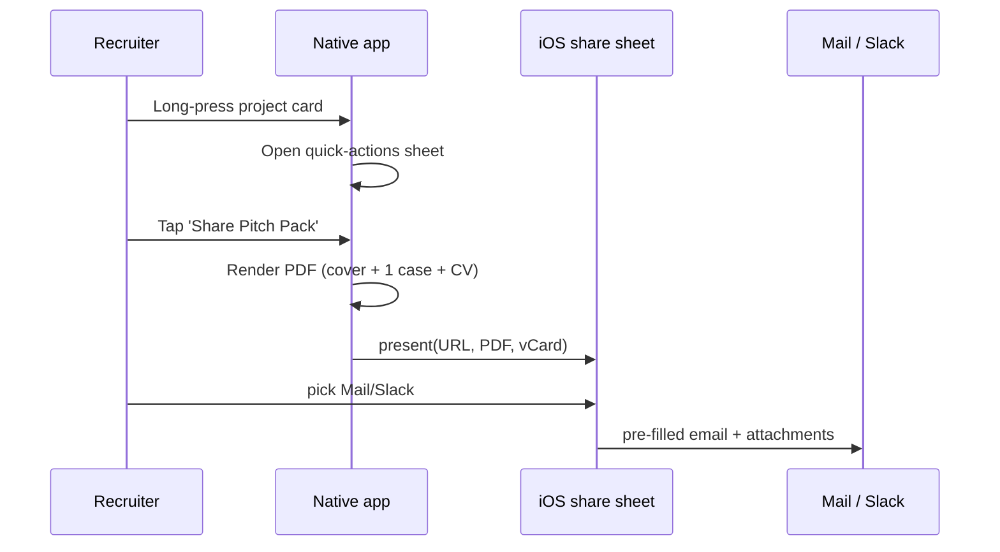
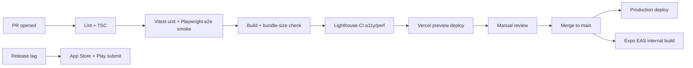
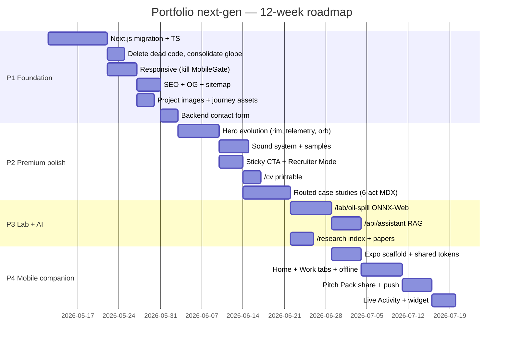

# Portfolio — Next-Gen PRD

> Implementation-ready specification for evolving `portfolio-main` into a two-surface premium personal platform: a refined cinematic web experience and a companion native mobile app, without altering the established dark-and-gold visual identity.

| Field | Value |
|---|---|
| Owner | Korukonda L K M Prem Chand |
| Status | Draft v1.0 — locked decisions |
| Last updated | 2026-05-06 |
| Source repo | `portfolio-main` |
| Targets | Web (Next.js 15) + Mobile (React Native + Expo) |

---

## 0. How to read this document

- **§1–§4** — strategy and analysis (the "why").
- **§5** — architecture (the "how at the system level").
- **§6** — full PRD (36 sub-sections, the "how at the spec level").
- **§7** — Phase 1 engineering tasks (ready to start).

When implementing, the AI-agent coding rules in §6.36 are binding.

---

## 1. Locked decisions (2026-05-06)

| # | Decision |
|---|---|
| Audience | Recruiters primary, research / grad-school secondary |
| Hero | **Evolve** the existing globe into "Living Data" — keep the WebGL Earth, polish cinematically |
| Routing | Hybrid: scroll home + routed `/work/[slug]`, `/research`, `/lab`, `/cv` |
| Framework | Migrate Vite → **Next.js 15 App Router** (SSR, OG, serverless). Visual identity preserved 1:1 |
| Color | **Unchanged.** Dark + gold #D4AF37, Syne + Inter, glass surfaces |
| Mobile | Responsive web **plus** a companion **React Native + Expo** mobile app |
| Backend | `data.json` + MDX case studies + Vercel serverless functions |
| Flagship lab | In-browser CNN oil-spill demo (ports SpillSight) |
| Sound | Tasteful subtle cinematic — preserved synth + curated samples; mute persisted |

---

## 2. Project understanding (Phase 1)

### 2.1 Stack & engineering snapshot (verified)

| Layer | Implementation | File evidence |
|---|---|---|
| Framework | React 19.2 + Vite 7.2 | [package.json](../package.json), [vite.config.js](../vite.config.js) |
| 3D / shaders | three 0.171, @react-three/fiber, drei, vite-plugin-glsl | [src/components/EarthShadersCanvas.jsx](../src/components/EarthShadersCanvas.jsx) |
| Animation | framer-motion 12.23 + CSS keyframes | [src/sections/](../src/sections/) |
| Routing | `react-router-dom` installed but **not wired** — single scroll-snap page | [src/App.jsx](../src/App.jsx) |
| Styling | Vanilla CSS + CSS custom-property design tokens | [src/index.css](../src/index.css) |
| Type system | None (JSX/JS only, despite `@types/react` present) | repo-wide |
| Backend | None — contact form is `mailto:` fallback | [src/sections/ContactSection.jsx](../src/sections/ContactSection.jsx) |
| Audio | Web Audio API procedural synth | [src/hooks/useSound.js](../src/hooks/useSound.js) |
| Optional AI | Gemini integration in mock VS Code if `VITE_GEMINI_API_KEY` set | [src/components/VSCodeEditor.jsx](../src/components/VSCodeEditor.jsx) |

### 2.2 Brand & positioning


- **Person:** Prem Chand Korukonda — ELC undergrad, Amrita (CGPA 8.94), AI/ML minor.
- **Triple specialty:** Embedded AI (STM32/ARM) ⊕ Deep Learning (CV / U-Net) ⊕ WebGL/Three.js storytelling.
- **Proof points:** 3 IEEE/SSRN papers, hackathon win, 500+ household sustainability impact, VP ELITE Club.
- **Voice:** "Architectural minimalism and interactive storytelling" — gallery restraint, dark + gold, Syne + Inter.
- **Promise:** *"I build systems that think — from silicon to satellites."*

### 2.3 UX/UI evaluation

| Dimension | Verdict | Notes |
|---|---|---|
| Visual hierarchy | Strong | Generous whitespace, `clamp()` typography, 8-pt grid |
| Motion design | Strong | Spring physics on Journey, magnetic cursor, infinite marquee — risks fatigue |
| Typography | Strong | Syne + Inter pairing is current and tasteful |
| Accessibility | Mixed | Semantic + ARIA + reduced-motion respected; missing alt text, MobileGate blocks <1024px, no skip-link |
| Responsiveness | **Critical gap** | Site is desktop-only |
| SEO | **Critical gap** | Only `<meta description>`. No OG, JSON-LD, sitemap, canonical |
| Performance | At risk | 9 Earth implementations bundled, no image optimization |
| Storytelling | Underdeveloped | Sections list facts; no narrative spine |
| Conversion | Underdeveloped | No CTA hierarchy, no recruiter mode, contact goes nowhere |

### 2.4 Strengths

1. Cinematic first impression (LoadingScreen gated on WebGL ready + 5s minimum).
2. Custom CMD+K Omnibar with cross-content search and keyboard nav.
3. Procedural Web Audio UI feedback — no payload cost.
4. Cohesive design-token system (CSS variables).
5. Magnetic cursor + spring physics — interaction polish that reads "senior."
6. Real shader work (custom Earth via vite-plugin-glsl).

### 2.5 Weaknesses & technical debt

1. **9 redundant Earth/globe components** — only `EarthShadersCanvas` is used; 8 are dead weight.
2. **Entire `src/pages/` directory unused** — 12 stale page components.
3. **`ThemeToggle.jsx` exists but is never mounted** — dark mode hardcoded.
4. **MobileGate blocks the entire site under 1024 px** — single largest UX/business risk.
5. **Contact form has no backend** — falls back to `mailto:`.
6. **No SEO infrastructure.**
7. **No analytics.**
8. **No type safety.**
9. **No error boundaries** — a Three.js crash takes down the page.
10. **Project images empty** in `data.json`; journey images point at non-existent files.

---

## 3. Next-gen reimagining (Phase 2)

### 3.1 Brand identity — preserved + codified

| Aspect | Direction |
|---|---|
| Tagline | *"I build systems that think — from silicon to satellites."* |
| Color | Dark base + gold #D4AF37 (preserved). Optional `--signal-cool #C8DCE6` ≤ 10% surface, telemetry only |
| Type | Syne (display) + Inter (body) **+ JetBrains Mono** (telemetry/code) |
| Motion | "Stillness is the default; motion is meaning." |
| Voice | First-person, specific, concrete > poetic |

### 3.2 Hero concept — "Living Data" (chosen)

Evolves the existing `EarthShadersCanvas`. Globe is preserved; cinematic polish is **additive**.

### 3.3 Information architecture



### 3.4 Premium experience moments

- **Recruiter Mode** — `?r=1` or top-right toggle re-skins home into a one-screen résumé.
- **Live status pill** — "Open to research roles" / "Available for collab" / "Heads-down — back on YYYY-MM-DD".
- **Scrollytelling case studies** — six-act narrative per project.
- **Interactive lab** — in-browser ONNX-Web CNN inference for oil-spill detection.
- **Easter egg `~`** — opens a real terminal with `whoami`, `ls`, `cat about.md`, `run inference --image=oil.png`.
- **Print-perfect `/cv`** — single source of truth; browser print → flawless 1-page PDF.

---

## 4. Gap detection & feature expansion (Phase 3)

| # | Feature | Why | Complexity |
|---|---|---|---|
| 1 | Real responsive layout (kill MobileGate) | Largest single drop-off | M |
| 2 | Routed case-study pages | SEO + depth + shareability | M |
| 3 | MDX content engine + research/blog | Demonstrates IEEE work | M |
| 4 | Backend contact form (Resend + Turnstile) | mailto: is invisible | S |
| 5 | Recruiter Mode | Recruiters spend ~14 s | S |
| 6 | Schema.org + OG + sitemap + per-route meta | Currently invisible to Google | S |
| 7 | Vercel Analytics + custom events | Decision-making over guessing | S |
| 8 | Live status field | Trust, removes ambiguity | S |
| 9 | Print-styled `/cv` | One source of truth | S |
| 10 | Interactive lab playground | Show, don't tell | L |
| 11 | Bundle audit + Earth consolidation | Faster TTI | S |
| 12 | TypeScript migration | Confidence to ship | M |
| 13 | Error boundaries + fallback UI | Graceful degrade for older GPUs | S |
| 14 | Theme toggle | User preference | S |
| 15 | AI assistant ("ask my portfolio") | Demonstrates AI/ML positioning | M |
| 16 | GitHub activity widget | Visible heartbeat | S |
| 17 | Open Graph image generator | Branded link previews | S |
| 18 | Companion native mobile app | First-class field tool | L |

---

## 5. System & experience architecture (Phase 5)

### 5.1 High-level architecture

```mermaid
graph TB
  subgraph Client[Client surfaces]
    W[Next.js 15 web<br/>App Router]
    M[React Native + Expo<br/>iOS + Android companion]
  end

  subgraph Edge[Vercel Edge / Serverless]
    F1[/api/contact<br/>Resend + Turnstile/]
    F2[/api/assistant<br/>Claude Haiku 4.5 stream/]
    F3[/api/github<br/>cached daily/]
    F4[/api/og<br/>@vercel/og dynamic OG/]
    F5[/api/status<br/>availability flag/]
  end

  subgraph Content[Content layer — versioned in repo]
    D[data.json<br/>profile, skills, projects index]
    MDX[content/work/*.mdx<br/>content/research/*.mdx]
    A[/public/assets/<br/>images, video, audio/]
  end

  subgraph External[External services]
    R[Resend — email]
    T[Cloudflare Turnstile]
    AI[Anthropic Claude Haiku 4.5]
    GH[GitHub GraphQL]
    AN[Vercel Analytics + Speed Insights]
  end

  W --> F1 & F2 & F3 & F4 & F5
  M -. shares .- D & MDX
  M --> F1 & F2 & F3 & F5
  F1 --> R & T
  F2 --> AI
  F3 --> GH
  W --> AN
  M --> AN
  W --> D & MDX & A
```

**Key principle:** content layer is **shared** between web and mobile (single source of truth).

### 5.2 Component hierarchy (web)

```mermaid
graph TD
  App[app/layout.tsx] --> Shell[Shell]
  Shell --> Cursor[MagneticCursor]
  Shell --> Omni[Omnibar CMD+K]
  Shell --> AudioCtx[SoundProvider]
  Shell --> StatusPill[LiveStatus]
  Shell --> RouteContent
  RouteContent --> Home[/]
  Home --> Hero[HeroScene]
  Hero --> Globe[EarthShadersCanvas — preserved + evolved]
  Hero --> Telemetry[LiveDataOverlay]
  Hero --> CTA[PrimaryCTA + SecondaryCTA]
  Home --> About & Tech & Exp & Edu & Code & Projects & Journey & Contact
  Projects --> Card[ProjectCard]
  Card -. links to .-> CaseStudy[/work/slug]
  CaseStudy --> CSHero & CSNarrative & CSDiagram & CSResults & CSReflection & CSNext
  RouteContent --> Lab
  Lab --> CNNDemo[OilSpillDemo — ONNX-Web]
```

### 5.3 Hero — globe evolution (state machine)



**What we add (no replacement):**
1. **Atmospheric rim shader pass** — soft fresnel glow.
2. **Day/night terminator drift** — 1°/30 s precession using existing earthlights texture.
3. **Cursor-tracked parallax** — globe tilts ~3° toward cursor with damped spring.
4. **Live telemetry overlay** beside globe — fake but believable embedded boot lines, rotates every ~12 s.
5. **Persistent corner orb** — globe shrinks into a 24px ambient orb top-right when hero scrolls out.
6. **One-time intro** — first visit only: 1.2 s ramp where the orb expands from a point.

**What we delete:** the 8 unused experimental globes — see §5.16.

### 5.4 Sound design system

**Philosophy:** *Stillness is the default; sound is meaning.* Opt-out, persisted, never plays before first user interaction. Reduced-motion → reduced-audio by default.

#### Sound library (15 cues)

| ID | Trigger | Source | Character | Loudness |
|---|---|---|---|---|
| `globe.idle` | Hero in view | Sample (drone) | Sub-audible warm pad, looped | –40 dB |
| `globe.touch` | Pointer enters globe | Synth | 1-cycle bell, 880 Hz | –20 dB |
| `globe.release` | Pointer leaves globe | Synth | Inverse bell tail | –24 dB |
| `ui.hover` | Hover any magnetic element | Synth | 12 ms 1200 Hz tick, low-pass | –28 dB |
| `ui.click` | Click button | Synth | Existing click | –20 dB |
| `ui.focus` | Keyboard focus moves | Synth | Sub tick 600 Hz | –30 dB |
| `nav.section` | Section enters viewport | Synth | Whoosh: 200→80 Hz sweep, 200 ms | –22 dB |
| `nav.route` | Route change begins | Sample | Cinematic transition (~600 ms) | –18 dB |
| `omnibar.open` | CMD+K | Synth | Existing open | –20 dB |
| `omnibar.close` | Esc | Synth | Existing close | –22 dB |
| `project.open` | Card → case study | Sample | Soft door-into-space (~800 ms) | –18 dB |
| `project.close` | Back to grid | Synth | Reverse | –20 dB |
| `loader.swell` | LoadingScreen 0→1 | Sample | 4 s rising bed, ducks at 100 % | –16 → –12 dB |
| `achievement.reveal` | Journey card flip-in | Synth | 2-note motif (G→D, soft) | –22 dB |
| `success.send` | Contact form sent | Synth | Two-note ascending major 6th | –18 dB |

#### Audio asset budget
- Synth cues: 0 KB (procedural via existing `useSound.js`).
- Sample cues (4): `loader.swell`, `nav.route`, `project.open`, `globe.idle`. Total **≤ 250 KB AAC + 320 KB OGG** dual-format, lazy-loaded after `loadeddata`.

#### Accessibility & UX rules
1. **Mute toggle** top-right (next to recruiter-mode toggle), persisted in `localStorage` as `audio.muted`.
2. **Default state:** desktop + `prefers-reduced-motion: no-preference` → on at –4 dB master. Mobile / reduced-motion → off.
3. **Honor `(prefers-reduced-motion: reduce)`** → drop swells/whooshes; keep only `ui.click` + `success.send`.
4. **No autoplay** — gate on first user gesture.
5. **WebAudio context resume** on first interaction; suspend on tab blur.
6. **Visual mirror** — every sound has a visual counterpart.
7. **Master ducker** — sample plays → synth bed ducks 6 dB for 150 ms.



### 5.5 Motion design system

| Principle | Rule |
|---|---|
| Default = stillness | Decorative motion only when scroll velocity > 0 or interaction occurred |
| Easing | `cubic-bezier(0.22, 1, 0.36, 1)` (out-quint) for entries; `cubic-bezier(0.65, 0, 0.35, 1)` for state changes |
| Duration tokens | `--motion-quick: 120ms` · `--motion-base: 240ms` · `--motion-slow: 480ms` · `--motion-cinema: 900ms` |
| Stagger | Max 3 children, 60 ms between. More than 3 → batch reveal |
| Transform-only | Animate `transform` and `opacity` only |
| Spring physics | Standardize Framer Motion: `{ stiffness: 220, damping: 28, mass: 1 }` |
| Respect reduced-motion | Disable parallax, marquee, swells, scroll-jack snap |
| 60 fps budget | Drop below 55 fps → demote that animation to opacity-only |
| Scroll storytelling | Each section: a single scroll-bound transform |

### 5.6 Scroll storytelling improvements

| Section | Today | Evolved scroll behavior |
|---|---|---|
| Home → About | Snap | Globe shrinks toward top-right while About fades up; single scroll-bound interpolation |
| Techstack | Endless marquee | Marquee speed binds to scroll velocity; pauses on hover; tooltips show proficiency |
| Code | Static VS Code mock | Editor "types itself" as user scrolls; terminal output reveals at 80% |
| Projects | Horizontal carousel | On click, card animates as a **shared element** into `/work/[slug]` |
| Journey | Spring fan-out | Horizontal timeline that scrolls horizontally during a pinned vertical section |
| Contact | Static form | Form floats up over a still globe at 30% — closes the visual loop |

### 5.7 Project / case-study presentation



**Image fallback:** every project gets an auto-generated cover via `@vercel/og` if `image` is empty in `data.json` — title + tags + brand chrome. **No card ever ships blank.**

### 5.8 Recruiter conversion flow



### 5.9 AI-native features

| Feature | Where | Tech |
|---|---|---|
| **Ask my portfolio** | Omnibar bottom: "Ask anything…" | RAG over `data.json` + MDX → Claude Haiku 4.5 streaming via `/api/assistant`. Strict system prompt: only answer from indexed content, refuse otherwise. Cite section/case study |
| **Auto-OG images** | Every route | `@vercel/og` JSX renders branded card per route |
| **Smart résumé re-ranker** | `/cv?role=embedded` | Re-orders skill chips and projects by role keyword (no LLM call, just weighting) |
| **Live "what I'm building"** | Footer | Cached GitHub GraphQL fetch shows latest push, daily |

> **Not** building: an AI chatbot in the hero. The assistant lives inside the existing Omnibar where intent is explicit.

### 5.10 Companion mobile app

**Stack:** React Native + Expo SDK 53, Reanimated 3, Skia (for Earth render), Zustand, MMKV, expo-router. Dark + gold tokens shared via Style Dictionary.

**Why a native app?** It's not a duplicate of the website. It's a **field tool**:
1. Recruiter share link opens a native experience instead of a degraded mobile site.
2. Push notifications when a new paper / project ships.
3. Offline portfolio for any field scenario.
4. Demonstrates cross-platform shipping — itself a hireable signal.

#### App information architecture



#### Mobile-native interactions (NOT on web)

| Feature | Detail | Why mobile-only |
|---|---|---|
| Hold-to-spin globe | Press-and-hold; haptic tick every 30°; release for inertia | Touch + haptics |
| 3D tilt parallax | DeviceMotion drives 2° hero tilt | Gyroscope |
| Long-press project card | Quick-actions sheet: open · share · save offline · save to Files | Native action sheet |
| vCard share | Long-press contact tab → share `.vcf` | Native contacts |
| Save-for-later | Star a project → cached MDX + assets in MMKV | Offline reading |
| Live Activity / Dynamic Island (iOS) | "Open to research roles · 3 days remaining" | iOS-only surface |
| Widget (iOS + Android) | 1×2 with live status + latest push hash + GPA | Home-screen presence |
| Recruiter Pitch Pack share sheet | Generates one PDF (cover + summary + 1 case + CV) | Native PDF + share |
| Camera AR mode (v2) | Globe drops onto a flat surface | ARKit/ARCore |
| Haptics across UI | `light` on touch, `medium` on toggle, `success` on send | No web equivalent |

#### Onboarding (first launch)

Three swipeable cards, ≤ 12 words each:
1. *"I make atoms think and pixels feel."* + globe orb spin.
2. *"Embedded · AI · WebGL — three crafts, one system."* + tri-icon morph.
3. *"Hold to spin. Tap to explore. Long-press to save."* + interaction hint.
End: "Allow notifications when new work ships?" → real ask.

#### Offline experience

- Static content (data.json, MDX, project covers, CV PDF) bundled on install (~3–5 MB).
- Asset CDN images cached on first open; revalidated on Wi-Fi via stale-while-revalidate.
- No backend dependency for core viewing.
- Contact form queues locally if offline; sends on reconnect with notification.

#### Recruiter share flow (mobile)



#### Web-only vs mobile-only vs both

| Feature | Web | Mobile |
|---|---|---|
| Full WebGL Earth (day/night, atmospheric pass) | ✅ full | ✅ Skia simplified |
| Cinematic loader with sample audio swell | ✅ | ✅ shorter |
| In-browser CNN inference lab | ✅ flagship | ❌ (links out) |
| MDX case studies (long-form) | ✅ primary | ✅ readable |
| `/cv` printable | ✅ | ✅ exports PDF |
| Recruiter Mode | ✅ | ✅ default mode |
| Omnibar CMD+K | ✅ | ❌ replaced by search tab |
| Magnetic cursor | ✅ | ❌ haptics replace |
| Pull-to-refresh, haptics, widgets, Live Activity, AR | ❌ | ✅ |
| Push notifications | ❌ | ✅ |
| Offline | partial (PWA) | full |

### 5.11 Performance budgets

| Metric | Web target |
|---|---|
| LCP (mobile, 3G) | ≤ 2.0 s |
| TBT | ≤ 150 ms |
| CLS | < 0.05 |
| JS shipped (route) | ≤ 180 KB gzip home, ≤ 90 KB case study |
| Lighthouse perf | 95+ desktop / 90+ mobile |
| A11y | 100 (CI gate) |
| First sound trigger | only after first user gesture |

### 5.12 SEO & discoverability

- Per-route metadata via Next App Router `generateMetadata`.
- `Person` JSON-LD on `/`; `CreativeWork` on each `/work/[slug]`; `ScholarlyArticle` on each `/research/[slug]`.
- Static `sitemap.xml` + `robots.txt` generated at build.
- Dynamic OG images via `@vercel/og` per route.
- Canonical URLs.
- RSS feed for `/research`.

### 5.13 Analytics

- Vercel Analytics + Speed Insights (free tier).
- Custom events: `cta_view_cv`, `cta_schedule`, `case_study_open`, `lab_run_inference`, `omnibar_query`, `assistant_query`, `share_pitch_pack`. ≤ 12 named events.
- Funnel: Hero → CTA → CV / Contact submit. Reviewed monthly.

### 5.14 Folder structure (post-migration)

```
portfolio/
├── apps/
│   ├── web/                              ← Next.js 15
│   │   ├── app/
│   │   │   ├── layout.tsx                ← Shell, cursor, omnibar, sound provider
│   │   │   ├── page.tsx                  ← Scroll-home composition
│   │   │   ├── (sections)/               ← Home sections as colocated TSX
│   │   │   ├── work/page.tsx
│   │   │   ├── work/[slug]/page.tsx
│   │   │   ├── research/page.tsx
│   │   │   ├── research/[slug]/page.tsx
│   │   │   ├── lab/page.tsx
│   │   │   ├── lab/oil-spill/page.tsx    ← ONNX-Web demo
│   │   │   ├── cv/page.tsx
│   │   │   └── api/
│   │   │       ├── contact/route.ts
│   │   │       ├── assistant/route.ts
│   │   │       ├── github/route.ts
│   │   │       ├── status/route.ts
│   │   │       └── og/[[...slug]]/route.tsx
│   │   ├── components/
│   │   │   ├── hero/                     ← Globe, telemetry overlay, CTA
│   │   │   ├── globe/                    ← ONLY EarthShadersCanvas (renamed Globe)
│   │   │   ├── omnibar/
│   │   │   ├── sound/                    ← SoundProvider, samples
│   │   │   ├── cursor/
│   │   │   ├── recruiter-mode/
│   │   │   ├── case-study/               ← MDX components
│   │   │   └── ui/                       ← Button, Card, Tag, etc.
│   │   ├── content/
│   │   │   ├── work/                     ← *.mdx case studies
│   │   │   └── research/                 ← *.mdx papers
│   │   ├── shaders/                      ← .glsl preserved
│   │   ├── public/
│   │   │   ├── audio/                    ← 4 sample files (AAC + OGG)
│   │   │   ├── earth/                    ← textures preserved
│   │   │   └── og/                       ← cached OG images
│   │   ├── styles/
│   │   │   ├── tokens.css                ← preserved CSS variables
│   │   │   └── globals.css
│   │   ├── lib/
│   │   │   ├── audio.ts
│   │   │   ├── analytics.ts
│   │   │   └── content.ts                ← MDX loader, frontmatter parsing
│   │   └── data/data.json                ← preserved
│   └── mobile/                           ← Expo
│       ├── app/                          ← expo-router
│       ├── components/
│       ├── content/                      ← shared with web at build
│       └── design-tokens/
├── packages/
│   └── design-tokens/                    ← single source for color/type/spacing
└── README.md
```

### 5.15 Refactor map

| Today | Action |
|---|---|
| `src/sections/*.jsx` | Port to `apps/web/components/sections/*.tsx` (TS) |
| `src/components/Earth*.jsx` (9 files) | **Delete 8;** keep `EarthShadersCanvas` → rename `components/globe/Globe.tsx` |
| `src/pages/*.jsx` (12 files) | **Delete entirely** |
| `src/components/ThemeToggle.jsx` | Wire into Shell |
| `src/components/MobileGate.jsx` | **Delete** — replaced by responsive layout |
| `src/components/Omnibar.jsx` | Port to TS; add `mode: 'search' \| 'assistant'` |
| `src/components/VSCodeEditor.jsx` | Port; gate Gemini behind documented feature flag |
| `src/components/MagneticCursor.jsx` | Port; disable on `(pointer: coarse)` |
| `src/hooks/useSound.js` | Port to `lib/audio.ts`; add sample loader, master mute, ducker |
| `src/data/data.json` | Preserved; extended with `availability`, `cv`, `og` fields |
| Contact form | Wire to `/api/contact` |
| `index.css` tokens | Move to `styles/tokens.css`; sync to `packages/design-tokens` |

### 5.16 Asset strategy

- **Project covers:** generate three real cover images at 1600×900 + 800×450 + 400×225, served via Next `<Image>`. Fallback: dynamic OG render via `/api/og/[slug]`.
- **Journey images:** real files OR `@vercel/og`-generated cards branded with date + title.
- **Earth textures:** preserved; converted to AVIF (~40% smaller) at build.
- **Audio samples:** 4 files dual-encoded (AAC + OGG) ≤ 250 KB total.
- **Image pipeline:** Next.js `<Image>` for raster; SVG inline for diagrams.

---

## 6. Full PRD (Phase 6) — 36 sections

### 6.1 Executive summary
Evolve the current portfolio into a two-surface premium personal platform — a refined cinematic web experience and a companion native mobile app — without altering the established dark-and-gold visual identity. Close shipping gaps (mobile-blocking, missing project images, no SEO, no backend, no analytics). Introduce a routed case-study system, in-browser ML lab, an "Ask my portfolio" assistant, and a tasteful sound layer. Preserve and elevate the globe hero.

### 6.2 Brand identity strategy
Identity preserved exactly. Codified:
- **Voice:** reserved, first-person, specific. Concrete > poetic.
- **Visual:** dark canvas, gold (#D4AF37) for craft and milestones, glass surfaces with subtle grain, breathing room over density.
- **Promise:** *"I build systems that think — from silicon to satellites."*
- **Signature:** the persistent globe orb that follows you from hero to footer.

### 6.3 Creative direction
"Stillness as default; motion as meaning." Curated gallery, not arcade. Sound and motion reward deliberate interaction. Every animation has a job; if it doesn't, it's removed.

### 6.4 Product vision
A platform — not a brochure — that (a) converts recruiters in under 30 s via Recruiter Mode, (b) earns research credibility through long-form case studies and indexed papers, (c) demonstrates technical taste through a working ML lab and a refined cinematic shell, and (d) extends to mobile and offline through a real native app.

### 6.5 Target audience
- **Primary** — engineering recruiters and hiring managers (embedded systems, ML, full-stack).
- **Secondary** — research / grad-school admissions committees.
- **Tertiary** — collaboration partners (academic, OSS, clients).

| Persona | JTBD | Success signal |
|---|---|---|
| Recruiter | Decide in 30 s if Prem fits | CV downloaded OR call scheduled |
| Hiring manager | Verify depth on 1 project | Case study scrolled > 70 % |
| Admissions committee | Confirm research output | `/research` visited + paper opened |
| Peer engineer | Save / share something cool | Pitch Pack share OR omnibar query |

### 6.6 UX strategy
1. Land in cinematic stillness; move only on intent.
2. Two clear paths from hero: *Work* (depth) and *CV* (speed).
3. One persistent way back home (globe orb + logo).
4. Always tell the user where they are (section progress, breadcrumbs on routes).
5. Reduce friction at every conversion edge.

### 6.7 Information architecture
See §3.3 (web) and §5.10 (mobile).

### 6.8 Feature breakdown

| Group | Feature | Description |
|---|---|---|
| Shell | Globe orb persistent | Hero globe shrinks into top-right orb on scroll out |
| Shell | CMD+K Omnibar | Preserved + add `mode: assistant` |
| Shell | Magnetic cursor | Preserved; disabled on coarse pointer |
| Shell | Sound layer | 15 cues with mute persistence |
| Shell | Live status pill | Pulled from `data.json.availability` |
| Shell | Recruiter Mode toggle | `?r=1` or top-right toggle |
| Hero | Living Data overlay | Telemetry lines beside globe |
| Hero | Atmospheric rim shader | New uniform on existing material |
| Hero | Day/night drift | Slow terminator precession |
| Sections | About / Tech / Exp / Edu / Code / Projects / Journey / Contact | Preserved; refined micro-interactions |
| Routes | `/work` + `/work/[slug]` | MDX case studies with six-act template |
| Routes | `/research` + `/research/[slug]` | Indexed publications with abstracts and PDFs |
| Routes | `/lab` + `/lab/oil-spill` | In-browser CNN inference (ONNX-Web) |
| Routes | `/cv` | Print-perfect résumé |
| API | `/api/contact` | Resend + Turnstile, queued from mobile if offline |
| API | `/api/assistant` | RAG over content → Claude Haiku 4.5 stream |
| API | `/api/github` | Cached daily latest activity |
| API | `/api/og/[slug]` | Dynamic OG cards |
| API | `/api/status` | Availability flag |
| Mobile | Hold-to-spin globe | Native gesture + haptic |
| Mobile | Pitch Pack share | One-tap PDF cover + case + CV |
| Mobile | Offline + push | First-class field tool |
| Mobile | Live Activity / Widget | Status surfaces on iOS/Android home |

### 6.9 UI component specifications

| Component | Props | Notes |
|---|---|---|
| `Globe` | `mode: 'hero' \| 'orb' \| 'mini'`, `scrollProgress`, `onReady` | Single component, three render sizes |
| `LiveDataOverlay` | `corpus: string[]`, `interval=12000` | Types lines, swaps every interval |
| `Omnibar` | `mode: 'search' \| 'assistant'` | Toggle inside, persists last mode |
| `Sound` (provider) | — | Exposes `play(id)`, `mute()`, `unmute()`, `isMuted` |
| `RecruiterModeProvider` | — | Reads `?r=1`, persists in localStorage |
| `LiveStatus` | `value: 'open-research' \| 'open-collab' \| 'heads-down'` | One-line pill |
| `ProjectCard` | `project: Project`, `onOpen` | Shared-element transition handle |
| `CaseStudyShell` | MDX provider w/ `Diagram`, `Metric`, `Beat`, `Reflection` slots | Six-act layout |
| `CTABar` (sticky) | `primary`, `secondary` | Hidden until past hero |
| `MuteToggle`, `RecruiterToggle`, `ThemeToggle` | bool, persisted |
| `OilSpillDemo` | — | `<canvas>` + ONNX runtime; latency badge |

### 6.10 Design system
Tokens live in `packages/design-tokens` and emit to web (CSS vars) and mobile (TS objects). Categories: color, type, spacing, radius, shadow, motion, sound, breakpoints, z-index.

### 6.11 Typography system

| Role | Font | Sizes |
|---|---|---|
| Display | Syne 600/700 | clamp(2.5rem, 6vw, 6rem) |
| Body | Inter 400/500/600 | 16/18/20 px |
| Mono (new) | JetBrains Mono 400/500 | 13/14/16 — for telemetry, code, terminal |

### 6.12 Color system

```
--bg-primary  #0A0A0B
--bg-elevated #121215
--bg-glass    rgba(255,255,255,0.03)
--text-primary   #F5F5F4
--text-secondary #A3A3A3
--accent-gold    #D4AF37
--accent-gold-soft #F4D484
--rule           rgba(255,255,255,0.08)
```

**New, optional** (telemetry/lab only): `--signal-cool #C8DCE6` ≤ 10 % surface.

### 6.13 Motion system
See §5.5.

### 6.14 Accessibility
- WCAG 2.1 AA site-wide; AAA on body text.
- Real focus order through every scroll section.
- Skip-to-content link.
- All images get alt text from `data.json.alt`.
- Magnetic cursor hidden under `(pointer: coarse)` and `prefers-reduced-motion: reduce`.
- Sound respects reduced-motion + persisted mute.
- Form errors inline + announced via `aria-live="polite"`.
- CMD+K dialog with `role="dialog"`, focus trap, restored focus on close.
- Lighthouse a11y CI gate at 100.

### 6.15 Responsive strategy
- Container queries for sections that flex independently.
- Breakpoints: 480, 768, 1024, 1440.
- **Hero:** below 768 px → static gold-rim Earth still image instead of WebGL.
- Bottom-anchored CTA on `< 768 px`.
- Touch targets ≥ 44 px.

### 6.16 Technical architecture
See §5.1.

### 6.17 Frontend architecture
- Next.js 15 App Router; React Server Components default; Client Components only where state/three.js/motion required.
- State: Zustand for shell-wide (sound, recruiter mode, theme); URL state for routes; local state where appropriate.
- Three.js loaded via `next/dynamic` with `ssr: false` and a static fallback.
- Framer Motion preserved.
- Style Dictionary → CSS variables (web) + TS tokens (mobile).
- TypeScript strict; ESLint + Prettier; CI gates.

### 6.18 Backend architecture
- Vercel functions (Edge runtime where possible).
- Resend for transactional email.
- Cloudflare Turnstile for spam.
- Anthropic Claude Haiku 4.5 for assistant (streaming).
- Vercel KV cache for GitHub feed (24 h TTL) and OG images.

### 6.19 API specifications

```
POST /api/contact
  body: { name, email, message, turnstileToken }
  200 { ok: true, id }
  400 { error }

POST /api/assistant
  body: { query, history?: [...] }
  stream: text/event-stream — token chunks
  refused if query > 1k chars or off-topic by system prompt

GET /api/github
  200 { latestPush: { repo, sha, message, ts }, contributions: number }
  cached 24h

GET /api/status
  200 { availability, updatedAt }

GET /api/og/[slug]
  png 1200x630 — branded
```

### 6.20 CMS / content strategy
- `data.json` — profile, skills, experience, education, journey, socials, availability.
- `content/work/*.mdx` — case studies (frontmatter: title, slug, summary, tags, cover, metrics[], year, status).
- `content/research/*.mdx` — papers (frontmatter: title, venue, year, abstract, pdf, doi).
- All version-controlled. CMS upgrade deferred until update frequency exceeds weekly.

### 6.21 SEO strategy
See §5.12. Plus: Search Console verification, IndexNow ping on deploy, RSS feed for research, OpenGraph debugger checked per route in CI.

### 6.22 Analytics & tracking
See §5.13.

### 6.23 Performance optimization
- Three.js code-split + only loaded when hero in viewport.
- Earth textures → AVIF, lazy.
- Fonts via `next/font` (self-hosted, subset).
- ONNX model lazy-loaded only on `/lab/oil-spill`.
- HTTP cache: long-cache hashed assets, short-cache HTML.
- `next/image` everywhere.
- Bundle analyzer gate in CI: home route ≤ 180 KB gzip.

### 6.24 Deployment strategy
- Web: Vercel (production = `main`, preview = PRs).
- Mobile: Expo EAS — internal track on every PR merge, store on tagged release.
- Single domain. Mobile app deep-links resolve same paths.

### 6.25 CI/CD plan



### 6.26 Security
- Strict CSP (no inline scripts except Next bundle), HSTS, frame-ancestors none.
- Turnstile on every form submission.
- Rate limit `/api/assistant` (5 req/min/IP) and `/api/contact` (3 req/min/IP).
- Secrets via Vercel env (no `.env` committed).
- Dependabot + npm-audit in CI.
- Mobile: certificate pinning for first-party APIs; Expo SecureStore for any token.

### 6.27 Testing strategy
- **Unit (Vitest):** content loaders, audio engine, recruiter detection, OG generator.
- **Component (Playwright + Storybook):** ProjectCard, Omnibar, CTABar.
- **E2E (Playwright):** recruiter funnel, case-study route, omnibar query, lab demo runs.
- **Visual regression:** hero, case-study cover, recruiter mode.
- **Mobile:** Detox e2e for splash → tabs → share Pitch Pack.
- **Accessibility:** axe-core in Playwright; manual screen-reader pass per release.

### 6.28 Conversion optimization
- One primary CTA above the fold; secondary "View work".
- Sticky CTA bar after hero on desktop ≥ 1024 px.
- Recruiter Mode auto-on for `utm_source=recruiter` or `?r=1`.
- `/cv` reachable in one click from anywhere.
- Contact form ≤ 3 fields + checkbox.
- A/B sketch (Phase 4): primary CTA wording.

### 6.29 Recruiter experience
See §5.8 + §5.10 (Pitch Pack share).

### 6.30 Client acquisition
- "Available for collaboration" pill swap.
- Light services strip on `/work`.
- Cal.com embed on `/contact`.

### 6.31 Suggested folder structure
See §5.14.

### 6.32 Refactor recommendations
See §5.15.

### 6.33 Technical debt analysis

| Debt | Severity | Phase to fix |
|---|---|---|
| 8 unused Earth components | High (bundle + cognitive) | P1 |
| Unused `src/pages/` | High (cognitive) | P1 |
| MobileGate blocks site | Critical | P1 |
| No TS | High | P1 (during migration) |
| No SEO infra | Critical | P1 |
| Mailto contact | High | P1 |
| No analytics | Medium | P2 |
| Missing project images | High (visual) | P1 |
| Silent Gemini gating | Low | P3 (replaced by `/api/assistant`) |

### 6.34 Feature roadmap



### 6.35 Implementation phases

**Phase 1 — Foundation (weeks 1–3).** No visible polish yet, but the site is scalable, mobile-real, indexed, and contactable. Gate to Phase 2: Lighthouse 90+ mobile, real responsive, contact form working, OG images live.

**Phase 2 — Premium polish (weeks 3–6).** The cinematic layer the brand has been promising. Gate to Phase 3: 60 fps hero, sound system shipped + accessible, case-study template ready, Recruiter Mode complete.

**Phase 3 — Lab + AI (weeks 6–8).** The credibility multiplier — show, don't tell. Gate to Phase 4: oil-spill demo ≤ 200 ms inference, assistant grounded and cited, three case studies live.

**Phase 4 — Mobile companion (weeks 8–12).** First-class native experience and field tool. Gate to launch: Pitch Pack share works on iOS + Android, offline core works, internal TestFlight build approved.

### 6.36 AI-agent coding instructions

When asked to implement parts of this PRD in this repo, follow these rules in order. (Binding for any agent — including Claude Code — picking up a task.)

1. **Preserve identity.** Do not introduce new colors, fonts, or layout conventions outside `packages/design-tokens`. Use existing CSS variables.
2. **Preserve the globe.** When migrating, reuse `EarthShadersCanvas` and its shaders. Do not regenerate from scratch.
3. **Delete before adding.** Phase 1 begins by deleting `src/pages/` and the 8 unused globe variants. Anything added should not increase the unique-component count without removing one.
4. **Code-split aggressively.** Three.js, Framer Motion, ONNX-Web, and audio samples must be dynamic imports. Home route ≤ 180 KB gzip.
5. **TypeScript strict, no `any`** except at well-commented IO boundaries. Convert files as you touch them.
6. **Content goes in `data.json` or MDX.** Never hardcode strings inside components for content.
7. **Every interactive element has:** an aria-label or visible label, a focus state, a sound cue (or explicit `silent` opt-out), a magnetic-cursor target, a reduced-motion fallback.
8. **Never autoplay audio.** Always gate on first user interaction; respect persisted mute.
9. **Default styles to dark + gold tokens.** No new accent unless used inside the telemetry layer.
10. **Server vs client.** Default to RSC. Add `"use client"` only when state, refs, motion, three.js, or audio are used.
11. **Test before shipping.** Each new component lands with a Playwright smoke test or Storybook entry.
12. **Mobile parity.** When implementing a feature in `apps/web`, decide whether it has a mobile counterpart per §5.10; if yes, file a tracking issue in `apps/mobile`.

---

## 7. Phase 1 engineering tasks (ready to start)

These are concrete, scoped tasks for week 1–3. Each is a one-PR shape.

| # | Task | Files touched | Acceptance |
|---|---|---|---|
| T1 | Initialize Next.js 15 monorepo (`apps/web`, `apps/mobile`, `packages/design-tokens`) | new tree | `bun dev` runs web on :3000 |
| T2 | Port `data.json`, sections, components into `apps/web` as TS | `apps/web/components/sections/*` | scroll-home renders identically to current |
| T3 | Delete `src/pages/` + 8 unused globe components | `src/pages/`, `src/components/Earth*.jsx` minus `EarthShadersCanvas` | bundle baseline shrinks ≥ 25 KB gzip |
| T4 | Replace `MobileGate` with responsive layout; static globe under 768 px | `components/hero/`, `styles/` | site usable on iPhone 14 viewport |
| T5 | Wire `ThemeToggle`; persist in localStorage; map tokens | `components/ui/ThemeToggle.tsx`, `styles/tokens.css` | toggle works, no FOUC |
| T6 | Per-route `generateMetadata` + JSON-LD Person/CreativeWork/ScholarlyArticle | `app/**/page.tsx` | rich-results test passes |
| T7 | `/api/og/[slug]` dynamic OG generator | `app/api/og/[slug]/route.tsx` | LinkedIn debugger shows branded card |
| T8 | Generate three real project covers + replace empty `data.json.image` | `public/work/*.avif`, `data/data.json` | every project card has a real image |
| T9 | Implement four journey assets — real photos OR auto OG cards | `public/journey/`, `data/data.json` | no broken image |
| T10 | `/api/contact` w/ Resend + Turnstile; wire `ContactSection` | `app/api/contact/route.ts`, `components/sections/ContactSection.tsx` | form delivers email; spam blocked |
| T11 | Vercel Analytics + custom `track()` for ≤ 12 named events | `lib/analytics.ts`, CTA components | events visible in Vercel |
| T12 | Lighthouse CI gate (perf 90+ mobile, a11y 100) | `.github/workflows/ci.yml`, `lighthouserc.json` | PR fails when below threshold |

---

## 8. Document conventions

- Mermaid diagrams render in any modern Markdown viewer (GitHub, GitLab, VS Code preview, Obsidian).
- File paths use repo-root-relative form for portability.
- "Preserved" means the implementation is moved, not redesigned.
- Severity tags: **Critical** (blocks shipping), **High** (visible friction), **Medium** (drag), **Low** (nice-to-have).

## 9. Change log

| Date | Author | Change |
|---|---|---|
| 2026-05-06 | Prem Chand + Claude Opus 4.7 | v1.0 — initial locked decisions, full PRD, Phase 1 task list |
